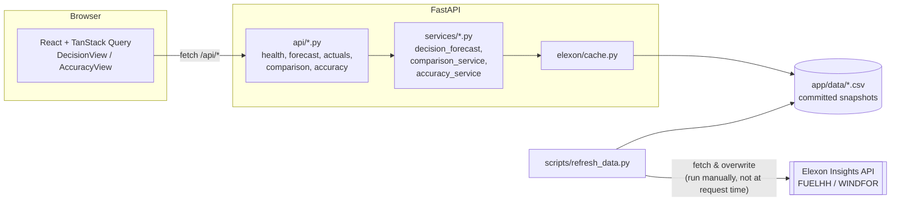

# Architecture

## Component diagram

The request path (`UI → API → services → cache → CSV`) never touches the network.
Only `refresh_data.py`, run manually and separately, talks to Elexon.

## Data flow

1. `refresh_data.py` fetches FUELHH (`WIND` fuel type, January 2026) and WINDFOR (from
   Dec 15 2025, for lookback) from `data.elexon.co.uk/bmrs/api/v1`, no API key, and
   writes `backend/app/data/{fuelhh_wind,windfor}.csv`. These are committed — the app
   never fetches live.
2. On each request, `elexon/cache.py` loads both CSVs with explicit dtypes/parsed
   dates (so tz-aware timestamps survive the round trip).
3. `services/decision_forecast.py` joins them: for each delivery day in the requested
   range, it computes the gate-closure cutoff, picks the latest eligible WINDFOR
   publish, and maps that run's hourly curve onto the day's half-hourly settlement
   periods (broadcast/hold).
4. `services/comparison_service.py` wraps that join for a date range.
5. `services/accuracy_service.py` computes error, horizon, decile, and the summary/
   sliced metrics (MAE, RMSE, bias, quantiles) over the joined series.
6. `api/*.py` validates query params, calls the services, and shapes the result into
   the Pydantic response models in `schemas/responses.py`.
7. The frontend fetches through a typed client (`api/client.ts`) via TanStack Query
   hooks (`api/hooks.ts`), rendering loading/empty/error states per query.

## Design decisions and rejected alternatives

**Hourly-to-half-hourly: broadcast/hold, not interpolation.**
WINDFOR publishes hourly; settlement periods are half-hourly. Each half-hour period
gets the forecast value for the clock hour containing its start time, held flat across
both halves. *Rejected*: linearly interpolating between adjacent hourly points — this
would imply a false sub-hourly precision the forecast was never published at, and
would misrepresent what the desk actually saw at decision time.

**Decision-time cutoff computed per delivery day, not per settlement period.**
Gate closure happens once each morning for the whole next day; picking a forecast per
settlement period would imply the desk re-decided 48 times a day, which it doesn't.
All 48 periods of a delivery day share one decision-time forecast run.

**Timezone-aware cutoff via `zoneinfo("Europe/London")`, not a fixed UTC offset.**
All Elexon timestamps are UTC. January 2026 is entirely GMT (UTC+0), so a hardcoded
`+00:00` offset would happen to produce correct results for this exact dataset.
*Rejected* anyway: the rule is "11:00 UK time," which means UTC+1 during BST. A
hardcoded offset would silently break the moment the scope extended past March. The
cutoff is built as a timezone-aware local datetime and converted to UTC, proven by a
synthetic BST-period unit test even though no real BST data is in scope.

**Caching strategy: committed CSV snapshot, offline-first, no live calls at request
time.** The brief requires the demo to work without relying on a live third-party API.
*Rejected*: fetching live per-request — adds latency, a network dependency, and a
failure mode entirely outside this app's control during a demo or review.
*Also rejected*: Parquet for the cache format (the original choice) — pulled in
`pyarrow`, a large wheel that made the Docker build fail on a slow connection with no
functional benefit at this data volume; switched to plain CSV with explicit
dtypes/`parse_dates`.

**Confidence band and safe volume use the whole month's error quantiles as a
constant-width band, not per-horizon or per-settlement-period quantiles.**
*Rejected*: slicing the quantile calculation itself by horizon or time-of-day — with
only one month of data, that leaves too few points per slice, and the resulting band
would be noisy/overfit rather than a more honest estimate. The sliced metrics are
still exposed separately in the Accuracy view's table, so the client can see how error
*varies* by time-of-day/horizon without that variation leaking into the band used for
sizing volume.

**Safe volume as an empirical quantile of the realised error distribution, not a
parametric (e.g. assumed-Gaussian, zero-mean) band.** This choice is what keeps
`safe_volume_mw` valid even though the error distribution isn't zero-mean (see the
data-coverage finding in `README.md`/`DEMO_SCRIPT.md`) — it makes no assumption that
would be invalidated by that finding.

**Errors returned as a consistent `{"error": {"code", "message"}}` JSON shape** across
400/404/422/503, via FastAPI exception handlers in `main.py`, rather than letting
different failure paths (bad params, no data, missing cache, no eligible forecast)
produce inconsistent shapes.
